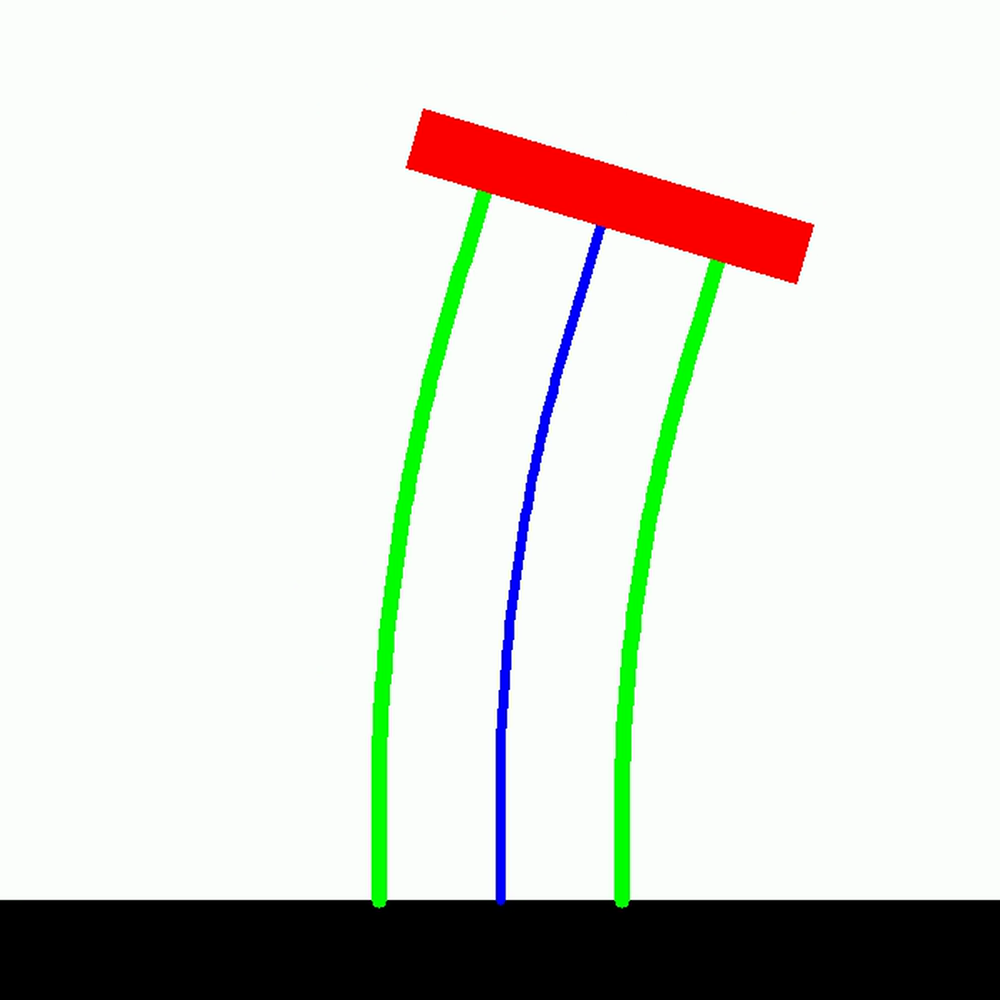

# Planar HSA

Planar Handed Shearing Auxetics (HSA) is a specialized planar PCS system for
multi-rod auxetic soft robots. It uses the common PCS propagation and dynamics
interfaces while adding HSA-specific rod geometry, platform and cap bodies,
underactuation, and optional Bouc--Wen hysteresis.

<figure markdown>
  { .soromox-figure }
  <figcaption>The specialized OpenCV renderer preserves the HSA platform and rod geometry in fast planar output.</figcaption>
</figure>

## API Reference

::: soromox.systems.pcs.planar_hsa.PlanarHSA
    options:
      show_root_heading: true
      show_source: false
      heading_level: 3
      group_by_category: true
      docstring_section_style: table
      members_order: source

## Model Features

- Piecewise-constant virtual-backbone strain with numerical Cosserat rod
  quadrature
- Multiple physical rods per segment
- Rigid caps, platforms, and end-effector offsets
- Optional motor-to-rod underactuation
- Optional Bouc--Wen hysteresis
- JAX-native kinematics, Jacobians, energies, and dynamics

## Specialized OpenCV Rendering

`OpenCVPlanarHSARenderer` extends the planar OpenCV backend with HSA rod and
platform geometry. It uses the [shared renderer configuration](../../rendering/configuration.md).

```python
from soromox.rendering import OpenCVPlanarHSARenderer

renderer = OpenCVPlanarHSARenderer(robot)
renderer.show(q)
```

::: soromox.rendering.planar_hsa.opencv_renderer.OpenCVPlanarHSARenderer
    options:
      show_root_heading: true
      show_source: false
      heading_level: 3
      docstring_section_style: table
      members_order: source

## Reference

Stölzle, M., Rus, D., & Della Santina, C. (2024). An experimental study of
model-based control for planar handed shearing auxetics robots. In
*Experimental Robotics: The 18th International Symposium* (pp. 153–167).
Springer. [doi:10.1007/978-3-031-63596-0_14](https://doi.org/10.1007/978-3-031-63596-0_14)
