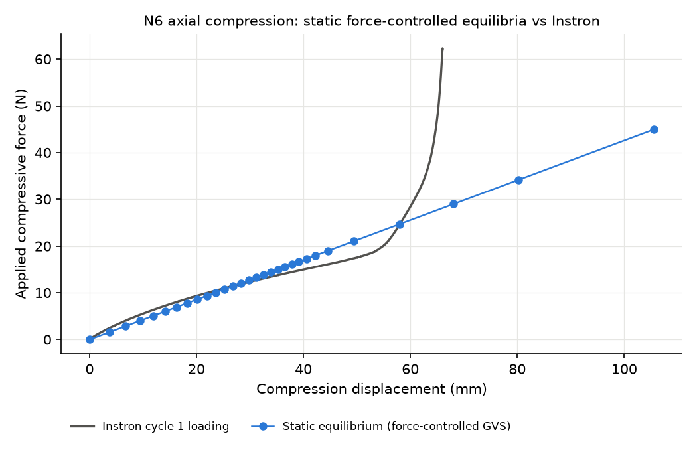
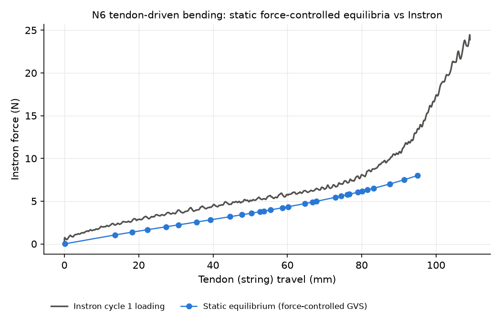

# N6 module: static force-controlled GVS equilibria vs Instron

Outputs of `examples/simulation/gvs/instron_static.py`, run on 2026-10-25 from
the checkout root with

```bash
JAX_PLATFORMS=cpu python examples/simulation/gvs/instron_static.py --experiment both --record
```

Every measured Instron force level is applied to the reduced GVS model of the
N6 module as an external load, the static equilibrium is solved for that load
alone, verified (force balance, constraints, tangent stiffness), measured, held
in Viser for 2.5 s and recorded as one point. No time integration, mass or
damping is involved. The model is defined in `n6_instron_model.py`: 12 solid
rectangular strands (12 x 2.93 mm section), 108 mm lattice, 7.5 mm rigid end
rings, E = 2.48 MPa, nu = 0.485, linear stiffness from the helix reduction.
Nothing is fitted to the measurements.

| Experiment | Force levels | Range | Converged / valid | Max force residual | Max constraint residual |
|---|---|---|---|---|---|
| Axial compression | 30 | 0.02 to 44.95 N | 30 / 30 | 1.7e-16 | 0 |
| Tendon bending | 30 | 0.01 to 7.99 N | 30 / 30 | 8.0e-16 | 0 |

The force residual is relative to the applied generalized load. The force caps
(45 N and 8 N) are the validity limits of the linear model: beyond them the top
ring would pass through the base, or the free ring would collide with the
clamped ring.

## Videos of the simulated force steps

One frame per equilibrium, 2 frames per second, 22 frames each (reference
configuration plus force steps 0 to 20). The solve runs all 30 levels and the
graphs below show all of them; the videos stop at step 20, where the linear
model is still close to the specimen. Each frame is a screenshot of the live
Viser scene taken by a headless browser after the hold: the solid rectangular
strands, the rigid 40 mm end rings, the string (bending), and the Viser panel
with the readout and the force-displacement graph as it fills in.

### Axial compression


Video file: [videos/compression_static.mp4](videos/compression_static.mp4)

| Reference | Step 6, 6.9 N | Step 13, 12.1 N | Step 20, 16.1 N |
|---|---|---|---|
|  |  |  |  |

### Tendon bending


Video file: [videos/bending_static.mp4](videos/bending_static.mp4)

| Reference | Step 6, 2.6 N | Step 13, 4.0 N | Step 20, 5.6 N |
|---|---|---|---|
|  |  |  |  |

## Force-displacement comparison with the Instron data

Grey: Instron cycle 1 loading branch (displacement-controlled test). Blue:
static equilibria of the GVS model at the measured force levels.

### Axial compression



| Force (N) | Model (mm) | Measured (mm) |
|---|---|---|
| 6.94 | 16.3 | 13.4 |
| 11.42 | 26.8 | 26.8 |
| 15.01 | 35.2 | 40.2 |
| 19.00 | 44.6 | 53.6 |
| 44.95 | 105.5 | 64.7 |

The model is linear with an axial stiffness of 0.426 N/mm, which is the
reduction's own tip compliance (confirmed by `test_compression_small_force_matches_lattice_axial_stiffness`).
It matches the measurement near 11 N, is stiffer below and softer above, and
cannot reproduce the densification the Instron shows past 55 mm.

### Tendon bending



| Force (N) | Model travel (mm) | Measured travel (mm) |
|---|---|---|
| 2.56 | 35.5 | 16.5 |
| 3.84 | 53.6 | 33.0 |
| 4.98 | 67.8 | 49.5 |
| 6.16 | 80.1 | 66.1 |
| 7.99 | 95.0 | 79.8 |

The string wrench follows the current chord from the free-ring hole to the
clamped-ring hole with the hole offset as moment arm. The model bends more than
the specimen at every level. Above 3.41 N the symmetrized tangent stiffness has
one negative eigenvalue. This is expected for a follower load and is recorded
in the CSV as `tangent_positive_definite = False`; the equilibria themselves
are verified by the force residual.

## Files

| File | Content |
|---|---|
| `compression_equilibrium.csv`, `bending_equilibrium.csv` | One row per force level: force, measured and static displacement, convergence, residuals, tangent eigenvalue, wrench components, measurements |
| `compression_instron_cycle1_loading.csv`, `bending_instron_cycle1_loading.csv` | The measured loading branch used for the comparison |
| `*_force_displacement.png` | The comparison graphs above |
| `*_diagnostics.json` | Spec, configuration, sample schedule and every record |
| `*_summary.json` | Counts, residual maxima, runtime, output paths |
| `videos/*_static.mp4`, `videos/*_static.gif` | The force-stepping videos |
| `videos/*_frames/NNN.png` | The individual frames |

## Reproducing

Tests (21, about one minute):

```bash
JAX_PLATFORMS=cpu python -m pytest tests/systems/test_n6_instron_model.py tests/systems/test_instron_static.py
```

`--record` records up to force step 20 by default; `--record-steps -1` records
every level. It needs Playwright (`pip install playwright`) and a Chrome or
Chromium it can launch; it screenshots the Viser scene headlessly, so no
browser window has to stay open.

Headless rerun without videos:

```bash
JAX_PLATFORMS=cpu python examples/simulation/gvs/instron_static.py --experiment both --no-viser
```

The equilibrium CSVs are deterministic: a rerun reproduces every physics column
exactly; only the wall-time column changes.
